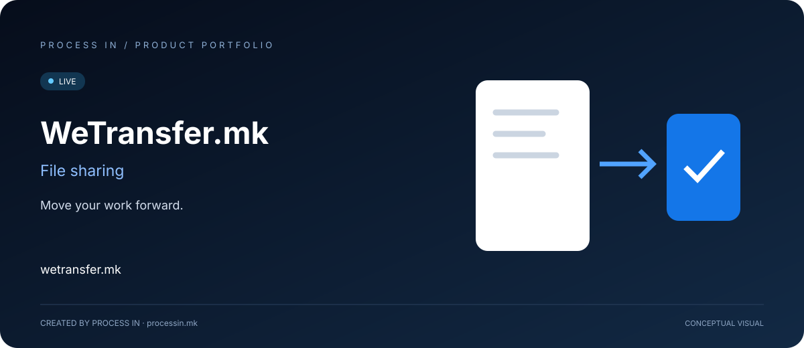

# WeTransfer.mk

**Move your work forward.**

[English](README.md) · [Македонски](README.mk.md)

**LIVE**

## Give a digital handoff a clear place to begin.

A project often needs a practical handoff: documents for a colleague, assets for a client or media from a creative collaborator. The recipient needs the files that belong to the work, and the sender needs a straightforward way to transfer them.

WeTransfer.mk presents a local file-sharing service for that exchange. The public experience starts with file upload and includes account, membership and contact sections.

## How to get started

| Step | Action |
|---|---|
| 01 | Open the service |
| 02 | Select files |
| 03 | Follow the transfer options shown |
| 04 | Share using the site's instructions |

## Core capabilities

| Area | What it offers |
|---|---|
| **File upload** | Start from the upload interface. |
| **File transfer** | Share work with recipients. |
| **Documents & media** | Use for project files and media. |
| **Accounts** | Access profile and sign-in sections. |
| **Membership** | Review premium options on the site. |
| **Contact** | Request assistance through the site. |

## Who it helps—and what they need

| Audience | Practical use |
|---|---|
| **Creative professionals** | Transfer project assets, documents or media to collaborators. |
| **Businesses** | Evaluate a file-transfer service for exchanging digital work. |
| **Individuals** | Share documents and media through the available transfer options. |

## Real situations to use it

### Sending a design handoff

Prepare the final assets and naming, select the files and follow the service's transfer instructions.

### Exchanging project documents

Group the relevant documents and check the transfer options and current service limits before sending.

## Why consider this solution

The value is a focused place for transferring files. A good handoff still starts with selecting the correct material and making its purpose clear to the recipient. The official service provides the current transfer options, membership terms and applicable limits.

## Product information

| Detail | Value |
|---|---|
| Website | [wetransfer.mk](https://wetransfer.mk/) |
| Category | File sharing |
| Status | LIVE |
| Developer | [PROCESS IN](https://processin.mk) |
| Portfolio contact | [contact@processin.mk](mailto:contact@processin.mk) |

Presentation sources: [1](https://wetransfer.mk/).

### [Visit WeTransfer.mk](https://wetransfer.mk/)

[PROCESS IN — Your Enterprise Software & AI Partner](https://processin.mk)

---

Public product presentation. No proprietary application code or customer data.

This platform is a digital product of <a href="https://processin.mk" target="_blank">PROCESS IN</a> · Your Enterprise Software & AI Partner ·  
Hosted on Enterprise Infrastructure by <a href="https://inhost.mk" target="_blank">INHOST</a> ·
